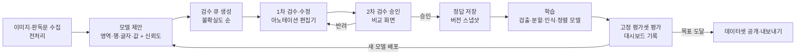
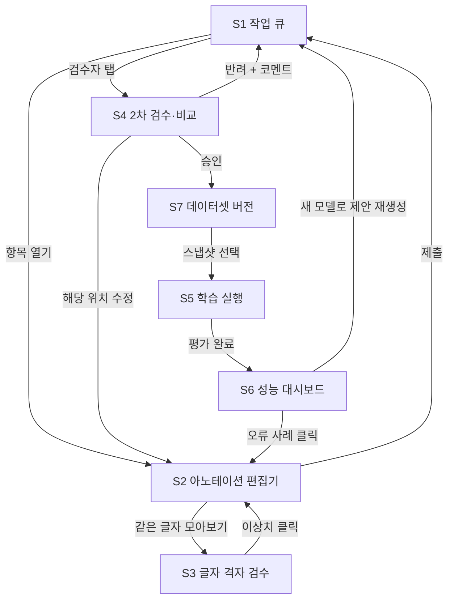

# OCR 데이터 구축용 아노테이션 도구 · 반복 학습 · 성능 대시보드 설계

대상: 국립한글박물관 소장자료총서 4종(사민필지 · 간이벽온방언해 · 삼강행실도언해 · 김씨부인 외) 공통. 첫 적용 대상은 품질 문제가 가장 컸던 『김씨부인 한글상언 · 정조어필 한글편지첩 · 곤전어필』입니다(6장).
범위: 레이아웃, 화면, 화면 간 흐름까지이며 구현은 포함하지 않습니다.

---

## 0. 설계 원칙 — 지난 작업에서 얻은 교훈

지난 샘플에서 품질이 떨어진 원인은, **기계가 추정한 값을 정답처럼 저장한 것**입니다. 대표적인 예는 다음과 같습니다.
- 행마다 글자 수를 강제로 맞추려고 등분한 상자
- 상자 개수만 맞춰 판독문과 짝지은 글자 값
- 줄바꿈이 다른 판독문을 추정으로 행에 나눠 담은 결과

겉보기에는 그럴듯하지만 틀린 라벨이 섞여 있어서, 데이터 전체를 믿을 수 없게 되었습니다.

그래서 이 도구는 다음 원칙을 따릅니다.

1. **제안과 정답을 분리한다.** 기계가 낸 값은 `proposed` 상태로만 존재합니다. 사람이 확정(`accepted`/`corrected`)한 것만 학습용 정답(gold)이 됩니다.
2. **모든 라벨에 출처·상태·신뢰도·이력을 둔다.** 누가(모델 버전 또는 작업자) 언제 무엇을 바꿨는지 되돌릴 수 있어야 합니다.
3. **자신 없는 제안은 숨기지 않고 드러낸다.** 신뢰도가 낮으면 색으로 경고하고 검수 순서를 앞당깁니다. 강제로 채워 넣지 않고 "비어 있음"으로 남깁니다.
4. **사람이 가장 싸게 고칠 수 있는 단위로 고친다.** 행 경계, 판독문 줄바꿈 위치, 글자 상자 병합·분할처럼 한 번의 조작으로 여러 라벨이 따라 바뀌어야 합니다.
5. **평가셋은 처음부터 고정하고 학습에 섞지 않는다.** 라운드마다 같은 잣대로 성능을 비교하기 위해서입니다.

---

## 1. 반복 루프 (Human-in-the-loop)



| 단계 | 담당 | 산출물 |
|---|---|---|
| 모델 제안 | 시스템 | `proposed` 라벨 + 신뢰도. 첫 라운드는 지금까지 만든 규칙 기반 파이프라인(HanOCR v0.7): 판독문 정렬, 도판 검출, 수동 보정 파일 |
| 1차 검수 | 작업자 | `corrected` 또는 `accepted` 라벨, 수정 이력 |
| 2차 검수 | 전문가(판독 가능자) | `approved` 또는 반려 사유 |
| 정답 저장 | 시스템 | 데이터셋 스냅샷 (예: `gold-r03`) |
| 학습·평가 | ML 관리자 | 모델 버전 (예: `model-r03`), 평가 리포트 |

**라운드 운영 예시**

| 라운드 | 할 일 |
|---|---|
| R0 | 평가셋을 고정합니다. 부·서체별로 층화해 약 10%를 뽑고, 두 사람이 따로 주석해 일치도를 봅니다. 이어서 씨앗 셋을 검수합니다: 1부 42행, 2부 편지 3~4통, 3부 4~8면. |
| R1 | 씨앗 셋으로 학습한 뒤, 나머지 쪽에 새 제안을 뿌리고 불확실도 순으로 검수합니다. |
| R2~ | 검수량 대비 성능 향상을 대시보드에서 확인하며 반복합니다. |
| 종료 | 목표치를 넘으면 멈춥니다. 예: 자동 수락률 90% 이상, 평가셋 글자 오류율(CER) 5% 이하, 박스 IoU≥0.5 재현율 95% 이상. |

---

## 2. 데이터 모델 (화면 설계의 전제)

```
Project ─ Part(1부/2부/3부) ─ Page(PDF 쪽) ─ Image(편지·문서 조각·책 면)
Image ─ Region(봉투·서명·캡션·제목·문양 …) ─ Line(행) ─ Char(글자)
Image ─ Transcript(판독문·주석문·현대어역, 줄바꿈 표시 포함)
```

| 필드 | 설명 |
|---|---|
| `state` | `proposed` → `in_review` → `accepted`/`corrected` → `approved` (또는 `rejected`, `skipped`) |
| `source` | `model:r02`, `rule:v0.7`, `human:작업자ID` |
| `confidence` | 0~1. 상자, 글자 값, 행 배정 신뢰도를 각각 둡니다. |
| `history` | 변경 전후 값, 시각, 작업자, 사유 |
| `flags` | 회전, 삽입, 삭제, 판독 불가, 대두, 흘림 연결 등 |
| `split` | `train` / `eval`(고정) / `holdout` |

판독문 쪽에는 **원본 줄바꿈 위치**를 따로 저장합니다(곤전어필처럼 줄바꿈이 다른 경우). 이 줄바꿈 표시 하나가 행 배정 전체를 결정하므로, 가장 값싼 수정 단위가 됩니다.

---

## 3. 화면 목록

| ID | 화면 | 주 사용자 | 목적 |
|---|---|---|---|
| S1 | 작업 큐 | 작업자·검수자 | 무엇을 먼저 고칠지 고르고 배정받음 |
| S2 | 아노테이션 편집기 | 작업자 | 영역·행·글자·값을 검수하고 수정 |
| S3 | 글자 격자 검수 | 작업자·검수자 | 같은 글자끼리 모아 이상치를 한꺼번에 처리 |
| S4 | 2차 검수(비교) | 전문가 | 제안과 수정의 차이를 보고 승인·반려 |
| S5 | 학습 실행 | ML 관리자 | 스냅샷을 골라 학습·평가 실행 |
| S6 | 성능 대시보드 | 전원 | 라운드별 개선 확인, 오류 유형 분석, 해당 행으로 바로 이동 |
| S7 | 데이터셋 버전·내보내기 | ML 관리자 | 스냅샷 통계, 평가셋 관리, 내보내기 |

---

## 4. 화면 간 흐름



**사용자별 주요 경로**

| 사용자 | 경로 |
|---|---|
| 작업자 | S1에서 "내 할당" 첫 항목 → S2에서 행 경계·글자 수정, 단축키로 다음 행 → 제출 → S1 다음 항목. 가끔 S3에서 같은 글자 묶음을 일괄 검수 |
| 전문가 | S1 "승인 대기" → S4에서 변경점만 확인 → 승인, 또는 반려 사유 입력 → 작업자 큐로 돌아감 |
| ML 관리자 | S6에서 정체 구간 확인 → S7에서 스냅샷 생성 → S5 학습 → S6에서 비교 → 배포하면 S1 큐가 새 신뢰도로 재정렬 |

---

## 5. 화면별 레이아웃

### S1 작업 큐

```
┌───────────────────────────────────────────────────────────────────────────────┐
│ HanOCR 주석  | 프로젝트: 소장자료총서1 ▾ | 라운드 R02 (model-r02) | 👤 작업자A │
├───────────────┬───────────────────────────────────────────────────────────────┤
│ 필터          │ [내 할당 38] [미할당 120] [승인 대기 12] [반려됨 3]              │
│ 부: ☑1 ☑2 ☑3 │ 정렬: 우선순위(불확실도) ▾   검색: [편지 13 / 1a / 행 번호  ]   │
│ 서체:         ├────┬──────────┬────────┬──────┬────────┬───────┬──────┬─────┤
│  ☑정자 ☑흘림  │ 🖼 │ 항목     │ 부     │ 행수 │ 신뢰도 │ 상태  │ 담당 │ 예상│
│  ☑궁서       ├────┼──────────┼────────┼──────┼────────┼───────┼──────┼─────┤
│ 상태:         │ ▦  │ 편지 13  │ 2부    │ 14   │ ▓▓░░ .42│ 제안  │ A    │ 12분│
│  ☑제안 ☑진행 │ ▦  │ 곤전 1b  │ 3부    │ 10   │ ▓▓▓░ .61│ 진행  │ A    │ 8분 │
│  ☐승인완료   │ ▦  │ 상언 R1  │ 1부    │ 20   │ ▓▓▓▓ .88│ 제안  │ -    │ 5분 │
│ 신뢰도 < [0.7]│ …                                                           │
│ ☐ 평가셋 포함│                                                               │
├───────────────┴───────────────────────────────────────────────────────────────┤
│ 선택 3건 → [나에게 할당] [다른 작업자에게] [건너뜀 사유…]                     │
└───────────────────────────────────────────────────────────────────────────────┘
```
- 우선순위는 신뢰도가 낮은 순, 모델 간 불일치가 큰 순, 새 서체 순입니다(능동 학습).
- 평가셋 항목은 기본적으로 숨기고, 두 사람이 따로 주석하도록 별도로 배정합니다.

### S2 아노테이션 편집기 (핵심 화면)

```
┌──────────────────────────────────────────────────────────────────────────────────────┐
│ ◀ 큐 | 편지 13 · <편지 13> 1796.12.20. · PDF 22 | 모드: [영역][행●][글자] | 저장됨 ✓ │
├───────────┬───────────────────────────────────────────────┬──────────────────────────┤
│ 구조 트리 │ 이미지 캔버스                                  │ 판독문 정렬 패널         │
│           │ ┌───────────────────────────────────────────┐ │ 원문 ○ 주석문 ○ 현대어역│
│ ▾ LETTER  │ │  ┌──ENVELOPE (↻90°)──┐                     │ │──────────────────────────│
│   ▸ 봉투  │ │  └───────────────────┘                     │ │ 행1 ▸ 상풍의        ✓   │
│   ▾ 행 01 │ │   │▓│ │ │ │▒│ │ │ │ │ │ │ │ │            │ │ 행2 ▸ 긔후평안ᄒᆞ오 ⚠ │
│   ▸ 행 02 │ │   │▓│ │ │ │▒│ │ │ │ │ │ │ │ │  ← 행 박스 │ │ 행3 ▸ 신문안아ᄋᆞᆸ…    │
│   ▸ …     │ │   │▓│ │ │ │▒│ │ │ │ │ │ │ │ │    신뢰도색│ │  ┆ ← 줄바꿈 표시를 끌어 │
│   ▸ 서명  │ │                          [인장]           │ │    행 경계 이동          │
│   ▸ 문양  │ └───────────────────────────────────────────┘ │ 삽입 [셔]  삭제 [∎∎]    │
│           │ 🔍 100% | 레이어: ☑영역 ☑행 ☑글자 ☐제안원본 │──────────────────────────│
│ 이미지 목록│                                               │ 속성: 선택 항목         │
│ ▦ R0 ▦ R1 │                                               │ 라벨 [TEXT_COLUMN ▾]    │
│           │                                               │ 행번호 [02] 대두 ☑      │
│           │                                               │ 회전 [0° ▾] 판독불가 ☐ │
│           │                                               │ 출처 model:r02 · .41    │
├───────────┴───────────────────────────────────────────────┴──────────────────────────┤
│ 행 글자 띠 (선택 행: 행 2)                                                            │
│ [긔][후][평][안][ᄒᆞ][오]   ← 글자 조각 썸네일 + 제안 값, 클릭하면 값 수정           │
│  .9  .8  .4⚠ .9  .5⚠ .9     단축키: ←→ 이동  M 병합  S 분할  Enter 확정  Tab 다음 행 │
├──────────────────────────────────────────────────────────────────────────────────────┤
│ [되돌리기] [이 행 모두 수락 A] [이 행 다시 제안 R] [건너뜀]           [제출 → 다음 ▶]│
└──────────────────────────────────────────────────────────────────────────────────────┘
```

**모드별 도구**

| 모드 | 주요 조작 | 비고 |
|---|---|---|
| 영역 | 사각형 그리기·조정, 라벨 선택(봉투·서명·캡션·제목·문양·도판), 회전 각도 지정 | 캡션 텍스트와 figure_id·date·folio 입력란 |
| 행 | 행 박스 조정, 행 순서 바꾸기, **판독문 줄바꿈 표시를 끌어 행 경계 이동** | 곤전어필처럼 줄바꿈이 다른 판독문을 고치는 가장 빠른 방법 |
| 글자 | 상자 조정, 병합(M)·분할(S), 값 수정, 삽입·삭제·반복부호 플래그 | 행의 글자 수와 판독문 글자 수가 다르면 경고 |

**편집기 규칙**
- 신뢰도 색: 녹색(0.8 이상) / 노랑(0.5~0.8) / 빨강(0.5 미만). 빨강은 기본적으로 "제안 없음"으로 보여, 작업자가 처음부터 그리게 합니다.
- 행 경계를 옮기면 그 행과 이웃 행만 다시 제안합니다. 다른 행은 건드리지 않아 오류가 번지지 않습니다.
- 캔버스와 판독문 패널은 서로 연동됩니다. 한쪽에서 선택하면 다른 쪽이 강조되고, 행 번호(01~40)로 주석문·현대어역도 함께 따라갑니다.
- 모든 조작은 이력으로 남고, 제출 시 수정한 행과 수락한 행 수가 요약됩니다.

### S3 글자 격자 검수

```
┌─────────────────────────────────────────────────────────────────────────┐
│ 글자 격자 | 범위: 3부 곤전어필 전체 ▾ | 글자: [고 ▾]  128개 | 정렬: 유사도 낮은 순 │
├─────────────────────────────────────────────────────────────────────────┤
│ [고][고][고][고][고][고][고][고][고][고][고][고]   ← 대부분 비슷하면 통과   │
│ [고][고][고][고][고][고][고][고][고][고][고][고]                           │
│ [하⚠][고][ᄀ⚠]  ← 모양이 튀는 조각 = 잘못된 값 또는 잘못 자른 상자         │
├─────────────────────────────────────────────────────────────────────────┤
│ 선택 2 → [값 바꾸기 …] [편집기에서 열기 ↗] [정상으로 표시]   ☐ 승인된 것만 │
└─────────────────────────────────────────────────────────────────────────┘
```
- 같은 값으로 라벨된 조각을 모아 보면, 행이 한 칸 밀린 오류가 "모양이 튀는 조각"으로 바로 드러납니다. 곤전어필 1a의 「고」 문제가 이런 유형입니다.
- 목록은 모델 임베딩 기준으로 유사도가 낮은 순으로 정렬합니다.

### S4 2차 검수(비교)

```
┌───────────────────────────────────────────────────────────────────────────┐
│ 승인 대기: 곤전 1a (작업자A 제출, 수정 23건)                   [◀ 이전][다음 ▶]│
├──────────────────────────────┬────────────────────────────────────────────┤
│ 제안 (model-r02)             │ 수정 (작업자A)                              │
│ 이미지 + 박스                │ 이미지 + 박스 (변경된 박스만 강조)          │
├──────────────────────────────┴────────────────────────────────────────────┤
│ 변경 목록                                                                 │
│  행3 경계 이동: "…쇼리되" → "…쇼리"   ✓승인  ✗반려  💬                    │
│  행2 글자 분할: [시고] → [시][고]     ✓승인  ✗반려  💬                    │
│  행5 값 수정: 그 → 그 (상자만)        ✓승인  ✗반려  💬                    │
├───────────────────────────────────────────────────────────────────────────┤
│ [전체 승인] [반려 → 사유 필수]  일치도(평가셋 이중 주석 시): 0.96            │
└───────────────────────────────────────────────────────────────────────────┘
```

### S5 학습 실행

```
┌───────────────────────────────────────────────────────────────────────────┐
│ 학습 실행                                                  [+ 새 실행]     │
├───────────────────────────────────────────────────────────────────────────┤
│ 스냅샷 [gold-r03 ▾]  승인 글자 18,420 · 행 1,212 · 이미지 96 (평가셋 제외)  │
│ 학습 대상 ☑행 검출 ☑글자 분할 ☑글자 인식 ☑판독문 정렬 ☐영역 검출           │
│ 기반 모델 [model-r02 ▾]  증강 ☑회전 ☑번짐 ☑농담                          │
├────────┬───────────┬──────────┬────────┬────────┬────────────┬───────────┤
│ 실행   │ 스냅샷    │ 시작     │ 상태   │ CER    │ IoU재현율  │ 배포      │
│ r03    │ gold-r03  │ 10:20    │ 평가중 │ -      │ -          │           │
│ r02    │ gold-r02  │ 어제     │ 완료   │ 12.4%  │ 88.1%      │ ● 사용 중 │
│ r01    │ gold-r01  │ 3일 전   │ 완료   │ 21.7%  │ 79.5%      │           │
└────────┴───────────┴──────────┴────────┴────────┴────────────┴───────────┘
  완료된 실행 → [대시보드에서 비교] [배포 → 큐 재생성]
```

### S6 성능 대시보드

```
┌──────────────────────────────────────────────────────────────────────────────────┐
│ 성능 대시보드 | 평가셋: eval-v1 (고정) | 비교: [model-r02] vs [model-r03] | 부 [전체▾]│
├───────────────┬───────────────┬───────────────┬───────────────┬──────────────────┤
│ 글자 오류율   │ 박스 재현율    │ 행 정렬 정확도│ 자동 수락률   │ 쪽당 검수 시간   │
│ 9.8% ▼2.6p   │ 91.3% ▲3.2p   │ 96.0% ▲4.1p   │ 71% ▲9p       │ 7.2분 ▼1.8분     │
├───────────────┴───────────────┴───────────────┴───────────────┴──────────────────┤
│ ① 라운드별 추이 (선: CER·재현율·자동수락률, 막대: 누적 정답 글자 수)             │
│    R0 ─ R1 ─ R2 ─ R3                                                             │
├───────────────────────────────────────┬──────────────────────────────────────────┤
│ ② 부·서체별 성능 표                    │ ③ 오류 유형 분해 (평가셋)                │
│  1부 상언(정자)   CER 4.1%  재현 97%   │  행 밀림(시프트)   ███████ 34%           │
│  2부 편지(흘림)   CER 18.9% 재현 82%   │  상자 병합(붙은 글자) █████ 25%          │
│  3부 곤전(궁서)   CER 8.7%  재현 93%   │  상자 분할(조각)   ████ 19%              │
│                                       │  값 오인식         ███ 15% · 회전 누락 7% │
├───────────────────────────────────────┼──────────────────────────────────────────┤
│ ④ 학습량 대비 성능 곡선               │ ⑤ 검수 효율                              │
│  x: 승인 글자 수, y: CER (부별 선)     │  라운드별 수정률(수정/제안), 작업자 간     │
│  → 곡선이 평평해지면 데이터 추가 효과 ↓ │  일치도, 반려율                           │
├───────────────────────────────────────┴──────────────────────────────────────────┤
│ ⑥ 나빠진 사례 (r03이 r02보다 틀린 행) — 클릭하면 S2 해당 행으로 이동             │
│  편지 13 행4 · 곤전 2b 행10 · 상언 R1 행33 …                                     │
└──────────────────────────────────────────────────────────────────────────────────┘
```

**지표 정의**

| 지표 | 정의 | 목적 |
|---|---|---|
| 글자 오류율(CER) | 평가셋 행별 편집거리 합 / 정답 글자 수 | 값 인식 품질 |
| 박스 재현율·정밀도 | IoU≥0.5로 짝지어진 정답 박스 비율 / 예측 박스 비율 | 검출·분할 품질 |
| 행 정렬 정확도 | 판독문 행 배정이 정답과 완전히 같은 행의 비율 | 곤전어필형 행 밀림 탐지 |
| 자동 수락률 | 검수에서 수정 없이 수락된 제안 비율 (라운드별) | 사람 부담 감소 |
| 쪽당 검수 시간 | 편집기 체류 시간 중앙값 | 비용 |
| 작업자 간 일치도 | 평가셋 이중 주석의 박스 IoU·값 일치 | 정답 자체의 신뢰도 |
| 퇴행 사례 수 | 새 모델에서 새로 틀린 평가셋 행 수 | 배포 안전장치 |

**배포 규칙**: 새 모델은 다음 두 조건을 모두 만족할 때만 S5에서 "배포"할 수 있습니다.
1. 전체 CER과 박스 재현율이 나빠지지 않음
2. 부별로 어느 한 부도 1%p 이상 나빠지지 않음

### S7 데이터셋 버전·내보내기

```
┌──────────────────────────────────────────────────────────────────────────┐
│ 데이터셋 버전                                          [+ 스냅샷 만들기] │
├──────────┬──────────┬─────────┬─────────┬─────────┬────────────────────┤
│ 버전     │ 만든 날  │ 승인 글자│ 승인 행 │ 이미지  │ 비고               │
│ gold-r03 │ 오늘     │ 18,420  │ 1,212   │ 96      │ +곤전 3부 8면       │
│ gold-r02 │ 어제     │ 12,905  │ 842     │ 61      │                    │
├──────────┴──────────┴─────────┴─────────┴─────────┴────────────────────┤
│ 평가셋 eval-v1 (고정, 잠금 🔒): 이미지 12 · 이중 주석 일치도 0.95       │
│ 라벨 분포: BODY_CHAR 17,902 · INSERTED 41 · ENVELOPE 88 · DELETED 36 …   │
│ 내보내기: [HanOCR JSON] [COCO] [PAGE-XML] [행 이미지+텍스트(인식 학습용)]│
│ ☑ 승인된 라벨만  ☐ 제안 포함(상태 표시)                                 │
└──────────────────────────────────────────────────────────────────────────┘
```

---

## 6. 첫 라운드 계획 — 김씨부인 자료

| 부 | 첫 제안 방식 | 사람이 주로 고칠 것 | 씨앗 셋 |
|---|---|---|---|
| 1부 상언 | 판독문 행 번호로 행 정렬(현 파이프라인 결과가 가장 좋음) | 글자 상자 미세 조정 | 42행 전부 |
| 2부 편지 | 행 검출만 제안하고, 글자 상자는 신뢰도 낮으면 비워 둠 | 행 박스, 봉투 회전, 삽입 글자 위치, 흘림 글자 상자 | 편지 3~4통 |
| 3부 곤전어필 | 판독문 줄바꿈 표시 제안(신뢰도 표시) | 줄바꿈 위치 끌기 → 행 안 글자 자동 재분할 → 상자 조정 | 4~8면 |

첫 라운드에서 가장 효과가 큰 학습 대상은 **행 검출 + 글자 분할 모델**입니다. 행 밀림과 상자 병합·분할이 오류 대부분을 차지하기 때문입니다. 글자 인식 모델은 정답 조각이 수천 개 쌓인 뒤(R2 이후)에 투입합니다.

**다른 총서로 넓힐 때**

| 자료 | 첫 제안 방식 | 사람이 주로 고칠 것 |
|---|---|---|
| 사민필지 | 텍스트 레이어 판독문 정렬(샘플에서 판독문 글자의 94~99%가 배정됨) | 협주 경계, 지도 표기(회전 글자) |
| 간이벽온방언해 | 영인 검출 + 판독문 OCR 정렬 | 판독문 OCR 오류, 한자 옆 작은 독음 |
| 삼강행실도언해 | 영인 상자만 제안(판독문 OCR 불가) | 글자 값 전체 입력 → 인식 모델 씨앗 |

지도처럼 회전·곡선 표기가 많은 도판은 S2 편집기의 **영역 모드**에서 두 가지를 지정합니다. 하나는 표기 중심선(읽기 방향)이고, 다른 하나는 판독문 표기 목록에서 고른 값입니다. 이렇게 모은 라벨은 회전 글자 검출기의 학습 데이터로 쌓입니다(ROADMAP 1번).
